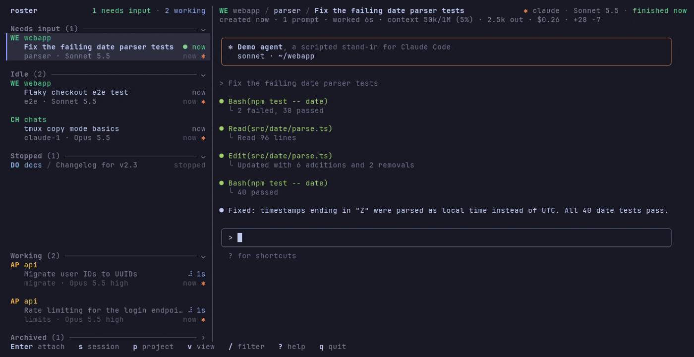

# agent-roster

A keyboard-first terminal manager for AI coding agent sessions (Claude Code for now).
Agents run in roster's own private tmux server; roster tracks whether each one is
working, needs input, is idle or stopped, and whether you've seen its latest turn.

Claude Code is tracked through its hooks; any other CLI agent can be added as a
generic agent, tracked by its screen.



<sub>The agents in the recording are a scripted stand-in for Claude Code
([demo/](demo/)).</sub>

## Install

Requires tmux ≥ 3.2 and Claude Code on `PATH`.

```sh
cargo install --path .     # installs `roster` into ~/.cargo/bin
```

To scroll back through an agent's history while attached, also set up
[scrolling back](#scrolling-back), and if you run roster inside your own tmux, the
[passthrough](#inside-your-own-tmux) there.

## Use

Run `roster` for the TUI: sessions on the left, the selected agent's screen on the right.

Navigate with `h j k l` (or arrows; the list wraps around); `Enter` attaches (or folds
a heading); in an agent, Ctrl+Q comes back and marks it read. `?` shows every key, and
`q` quits (in the projects and server views it goes back, like `Esc`). Everything
else is in three menus, which pop up their keys:

| Menu | Keys |
|---|---|
| `s` session | `n` new · `c` new chat (no project needed) · `e` edit · `s` start · `x` stop · `r` restart · `u` read/unread · `t` new title · `a` adopt a conversation · `d` archive / restore · `D` delete for good |
| `p` project | `n` new · `e` edit · `f` show only this project · `d` remove · `l` list (all projects; there these work without `p`) |
| `v` view | `g` group by project · `p` all projects · `t` tmux server and database |

Sessions sit on shelves by attention. At the top what waits for you: *Needs input*
(questions, finished turns you haven't seen), *Idle* and *Stopped*; at the bottom
what you've handed off or finished: *Working* (dimmed) and *Archived* (folded;
`Enter` restores one, `s D` deletes it for good). Within a shelf it's first come,
first served (configurable). Coming back from an agent you gave a task, the cursor
stays where it was, on the next one waiting; after only reading, it stays on that
agent.

New and edit open a form (`Tab`/`↑↓` move, `←→` change, `Enter` submits). Projects
carry a default agent, model and effort for their sessions; a new session can also
get a first prompt, typed into the agent once it's ready. `s c` starts a chat, a
session that needs no project: chats share one directory in a built-in project.

A Claude conversation started outside roster (plain `claude`, another session manager)
can be adopted with `s a`: pick it (typing filters, `Tab` shows those outside your
projects), and it continues as a session here, in its project or a new one for its
directory. Close it where it's open first, or adopt a copy and leave the original alone.

Everything is also available from the CLI:

```sh
roster project add myproj ~/src/myproj --model opus --effort high
roster project ls                       # directories, sessions, defaults
roster new myproj --name api --attach   # start Claude and go into it; Ctrl+Q comes back
roster new myproj --prompt "fix the failing tests"   # typed in once Claude is ready
roster chat --prompt "explain tmux copy mode"         # no project needed: a chat
roster edit api --model sonnet          # applies on the next start
roster edit api --title "Auth rework"   # your title; --title "" follows Claude's again
roster retitle api                      # a fresh title from Haiku, from the recent prompts
roster info api                         # created, prompts, time worked, context, tokens, cost
roster adopt --list                     # Claude conversations started elsewhere (--all: not only in your projects)
roster adopt 3f2a --name api            # continue one here; --fork adopts a copy instead
roster project edit myproj --effort default
roster ls                               # ● marks sessions with a turn you haven't seen
roster ls --project myproj --sort attention   # like the TUI's shelves
roster show api                         # print its current screen
roster attach api                       # going in and out with Ctrl+Q marks it read
roster stop api && roster start api     # start resumes the conversation
roster archive api && roster restore api   # archived sessions keep their conversation
roster rm api                           # delete an archived session for good (a Claude conversation can be adopted again)
roster events --follow                  # what the agents' hooks report
roster doctor                           # roster's tmux server and database, checked; --fix removes orphans
```

Sessions are addressed as `project/name`, `name`, or an id prefix. `roster --help`
lists every command.

## Configure

All files are optional and live in `~/.config/agent-roster/`:

- `config.toml`:
  - `shell`: what sources the env files (default `$SHELL` if POSIX-like).
  - `chats_dir`: where chats run (default inside roster's state directory).
  - `[order]`: per shelf (`needs_input`, `idle`, `stopped`, `working`, `archived`),
    `"oldest"` or `"newest"` first; by default first come, first served, and the
    archive newest first.
  - `[keys]`: every TUI key, plus `detach` for Ctrl+Q.
  - `[agents.claude] command`/`args`. Any other agent goes in its own table and is
    then offered for new sessions:

    ```toml
    [agents.aider]          # runs `aider`; or set command = "..."
    args = ["--no-auto-commits"]
    idle_after = 4          # seconds of a still screen that count as idle
    ```

    Such agents are tracked by their screen and can't resume, so roster asks before
    starting one again.
- `env`: sourced before every agent start, so `TOKEN="$(token-cmd)"` gets a fresh
  value each time. A `.agent-roster.env` in a project's directory is sourced after it.
- `tmux.conf`: additions to roster's tmux, such as the scrolling setup below. By
  default every key except Ctrl+Q goes to the agent.

State lives in `~/.local/state/agent-roster/`. Uninstall: remove the binary and both
directories, and `tmux -L agent-roster kill-server`.

## Scrolling back

An agent's history lives in roster's tmux, which by default has no prefix and passes
every key except Ctrl+Q to the agent. To scroll back, give it a prefix and copy mode:
copy [examples/tmux.conf](examples/tmux.conf) to `~/.config/agent-roster/tmux.conf`.

That example makes **`C-a` roster's prefix**, and this README uses `C-a` for it from
here on. It's only the example's choice: any key works. If you pick another, put it in
place of `C-a` in that file, in the snippet below, and wherever this README says `C-a`.

Then, while attached, `C-a [` (or `C-a Enter`) opens copy mode with vi keys (`k`/`j`,
`C-u`/`C-d`, `/` to search, `q` to leave), and `C-a C-a` sends a literal `C-a` to the
agent. Roster's tmux re-reads the file the next time roster starts (the TUI, or any
`roster` command), even with agents running.

## Inside your own tmux

Roster works inside your own tmux unchanged: its agents run on its own tmux server,
with its own small config, so your prefix and bindings stay out of the agents'
way and its sessions never show up in your session list.

Two prefixes are involved here: **yours**, written `<prefix>` below, and **roster's**,
`C-a` with the setup from [Scrolling back](#scrolling-back). Three things to know:

**Scrolling back.** Copy mode in *your* tmux shows your pane's older output (what ran
before roster), never the agent's history: that's in roster's tmux. So:

- If your prefix differs from roster's (yours is `C-b`, say), roster's `C-a [` in a
  roster pane already reaches roster's tmux. Nothing else to do.
- If they're the same key, your tmux takes it first: press it twice (`C-a C-a [`), or
  add this passthrough to your `~/.tmux.conf`
  ([examples/outer-tmux.conf](examples/outer-tmux.conf)). In a pane running roster,
  your usual `<prefix> [` and `<prefix> Enter` then send roster's `C-a [` / `C-a Enter`,
  opening copy mode on the agent's history; in every other pane they're your normal
  copy mode. It works with any prefix of yours; the `C-a` in it is roster's:

  ```tmux
  bind [     if -F '#{m:*roster,#{pane_current_command}}' { send-keys C-a [ }     { copy-mode }
  bind Enter if -F '#{m:*roster,#{pane_current_command}}' { send-keys C-a Enter } { copy-mode }
  ```

  While attached, your tmux reports the pane's command as `roster` (the attach runs
  in roster's process group), which is what the snippet matches.

**Copying.** `y` in roster's copy mode sends the selection to the terminal (OSC 52);
your tmux passes it on only with `set -s set-clipboard on` (its default, `external`,
drops it). Or copy straight to a clipboard tool from roster's `tmux.conf`:

```tmux
bind -T copy-mode-vi y send -X copy-pipe-and-cancel 'clip.exe'   # WSL; wl-copy, pbcopy
```

**Keys.** Keys your tmux binds without a prefix are taken by your tmux before they
reach roster, as in any pane: vim-tmux-navigator's `C-h/j/k/l`, say. Keep Ctrl+Q free
in your tmux, or change roster's back key (`detach` under `[keys]` in `config.toml`).
For Shift+Enter (a newline in Claude), a binding in your tmux such as
`bind -n S-Enter send-keys C-j` sends it on as Ctrl+J, which Claude also takes as a
newline.

## Develop

```sh
cargo test     # unit tests, plus end-to-end tests that need tmux
```

`ROSTER_TMUX_SOCKET=<name>` (and `XDG_CONFIG_HOME`/`XDG_STATE_HOME`) keep a
development build apart from your real sessions.

`demo/render.sh` records the GIF above from `demo/tapes/` with
[VHS](https://github.com/charmbracelet/vhs) in Docker, in a home of its own, with
`demo/env/fake-claude` as every agent.
