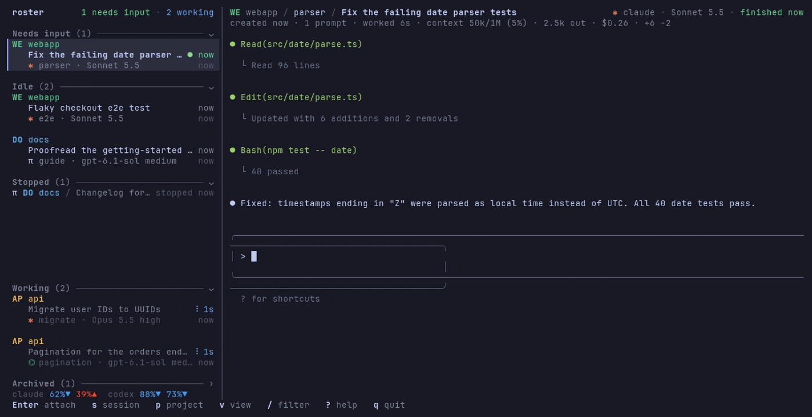
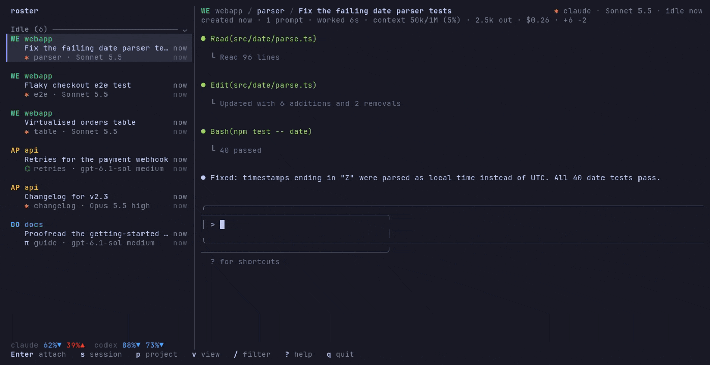
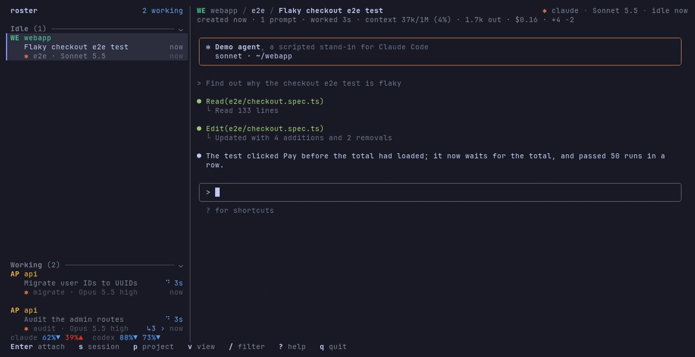
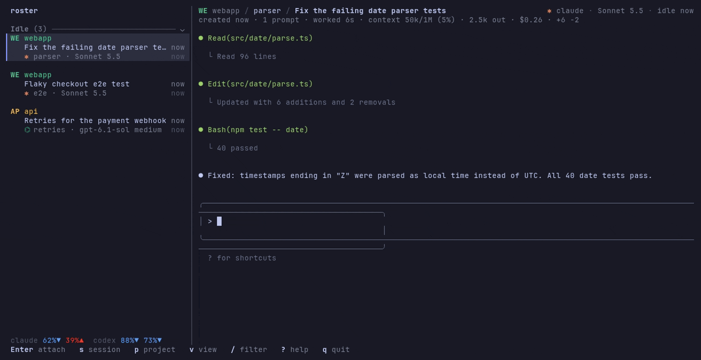
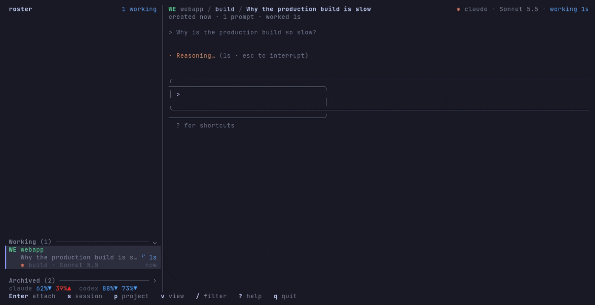
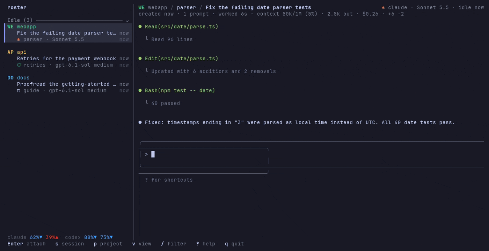

# agent-roster

A keyboard-first terminal manager for AI coding agent sessions: Claude Code, pi,
Codex, or any other CLI agent.
Agents run in roster's own private tmux server; roster tracks whether each one is
working, needs input, is idle or stopped, and whether you've seen its latest turn.

Claude Code is tracked through its hooks, [pi](#pi) through a small extension roster
loads into it, [Codex](#codex) through hooks it hands each run it starts; any other
CLI agent can be added as a generic agent, tracked by its screen.



<sub>The agents in the recordings are a scripted stand-in for Claude Code, pi and Codex
([demo/](demo/)); `fit_preview = "always"` keeps the session list beside the agent
you're in, and `memory_warning = "1G"` marks the runaway build.</sub>

## Install

Requires tmux ≥ 3.2, an agent on `PATH` (Claude Code, pi, Codex, or any CLI agent you
[configure](#configure)), and to build it a recent stable Rust
([rustup](https://rustup.rs)).

```sh
cargo install --git https://github.com/XobSod/agent-roster   # roster into ~/.cargo/bin
```

From a clone:

```sh
cargo install --path .     # the same, from the checkout
cargo build --release      # or only build it: ./target/release/roster
cargo build                # a debug build, quicker to build, slower to run: ./target/debug/roster
```

Installing puts only the `roster` binary in place. What else roster needs it makes
as it runs, in `~/.local/state/agent-roster/`: its database, its tmux config, and
the extension it loads into the [pi](#pi) sessions it starts.

To scroll back through an agent's history while attached, also set up
[scrolling back](#scrolling-back), and if you run roster inside your own tmux, the
[passthrough](#inside-your-own-tmux) there.

## Use

Run `roster` for the TUI: sessions on the left, the selected agent's screen on the right.
One runs at a time (a second one says where the first is); `roster` commands work
alongside it.

Navigate with `h j k l` (or arrows; the list wraps around); `Enter` attaches (or folds a
heading); in an agent, a line at the top says where you are, like the preview's header
(project, the session's name if you gave it one, and its title), and Ctrl+Q comes back
and marks it read. `/` filters the list as you type, fuzzily (`atrw` finds "Auth
rework"; `'word` matches exactly): `Enter` keeps the filter, `Esc` clears it. `?` shows
every key, and `q` quits (in a view it goes back, like `Esc`). Everything else is in
three menus, which pop up their keys:

| Menu | Keys |
|---|---|
| `s` session | `n` new · `c` new chat (no project needed) · `e` edit · `s` start · `x` stop · `X` kill (it and all it started, at once) · `r` restart · `u` read/unread · `t` new title · `o` note · `a` archive / restore · `D` delete for good · `A` adopt a conversation |
| `p` project | `n` new · `e` edit · `o` note · `f` show only this project · `d` remove · `l` list (all projects; there these work without `p`) |
| `v` view | `p` all projects · `t` tmux server, database and processes · `s` settings · `u` usage |

### Sessions and shelves

Sessions sit on shelves by attention. At the top what waits for you: *Needs input*
(questions, finished turns you haven't seen), *Idle* and *Stopped*; at the bottom what
you've handed off or finished: *Working* (dimmed) and *Archived* (folded; `Enter`
restores one, `s D` deletes it for good). Within a shelf it's first come, first served
(configurable). `group_by = "project"` puts them under each project instead, archived
ones still on their shelf. Coming back from an agent you gave a task, the cursor stays
where it was, on the next one waiting; after only reading, it stays on that agent. A
stopped or archived session's preview says what it was: when it stopped or was archived,
its project, title, note and last prompts, and whether starting it resumes its
conversation (one Claude or pi no longer has, as Claude deletes old ones, can't be:
starting it asks before a new one). For a stopped one whose agent exited with an error,
it also shows how the agent's screen ended (`roster show` prints all of it). A shelf's
or a project's heading previews its sessions at a glance: what each is waiting for and
since when, its last prompt, and its note's line.

Under the preview's header is what roster knows of the session: when it was made, its
prompts, the time it worked, and from its agent's conversation, the context used,
output tokens (its subagents' too), cost and lines changed.

### Finding your way



Beside `/`, `p f` shows only the selected session's project (again, all of them), and
the settings view (`v s`) changes a setting at once: `group_by`, say, to put the
sessions under their projects.

### New sessions, chats and adopting

New and edit open a form (`Tab`/`↑↓` move, `←→` change, `Enter` submits). Projects
carry a default agent, model and effort for their sessions, and each agent its own
(`model` and `effort` in its settings), used when neither the session nor its project
picks one; "default" leaves it to that. A new session can also get a first prompt,
typed into the agent once it's ready (Codex gets it on its command line; one Codex exited
before saying it took, at a screen it showed first, is kept, and starting it again asks
whether to give it again, as `--prompt-again` or `--no-prompt-again` answers on the CLI).
`s c` starts a chat, a session that needs no project: chats share one directory in a
built-in project.

A Claude, pi or Codex conversation started outside roster (plain `claude`, `pi` or
`codex`, another
session manager) can be adopted with `s A`: pick it (typing filters, `Tab` shows those
outside your projects), and it continues as a session here, in its project or a new one
for its directory. It goes on with the model and effort it last ran on (as far as its
agent recorded them), the defaults (the project's, if the project runs the same agent,
else the agent's), or ones you pick in the form (`--defaults`, `--model`, `--effort` on
the CLI). Close it where it's open first, or adopt a copy and leave the original alone.
Roster can tell when one is open in Claude, but not in pi or Codex.

### Subagents and shells



A Claude or Codex session's card says how many subagents it has at work, on its second
line: `↳2 ›`; one whose own turn ended with subagents still at work (in the background)
stays working until the last one is done. `l` on the card unfolds a line for each, the
model it runs, what it's doing (its latest step, in the manner of its agent's own
screen; what it was given to do till its first) and how long it's been at it; `h` folds
it again (`card_subagents` keeps them unfolded, the lines then saying how many, or
shows the count only). One unheard of for fifteen minutes is taken for gone.

Commands Claude left running in the background (a build, the tests, a dev server) are
counted beside them, `$1`, with a line each when unfolded: what it does, as Claude put
it, and how long it's been running. A turn that ends with only those left stays on
*Working*, marked unread (`● ⠋`): Claude may be waiting for one, taking its result up by
itself once it's done, which takes the mark off, or for you, with a server left running
for you to try. Codex's background terminals (`/ps`) count the same, a line each with
its command; Codex takes none of their results up, so the session is idle and unread
once the last ends or is closed (`/stop`). In a conversation begun by an older Codex,
which records no such end, they aren't counted.

### Notes



Each session can have a note, what's left to do in it, say. `s o` opens it under the
preview's header, the agent's screen still below, in an editor with vim's keys: normal,
insert and visual mode, motions (words of any letters), `c`, `d` and `y` with any motion
(`de`, `y$`, `cj`, `dfx`, `dG`, `dd`) or text object (`ciw`, `daw`, `yi(`, `ca"`, `dap`,
brackets nested and across lines; `v` too), counts (`3x`, `d2w`, `5G`, `3ifoo`, `3J`),
`C`, `r` (`rx` ticks a box, `.` the next), `xp` and `ddp`, `/` search, `u`, `.`. Not
there: `;` and `,`, `~`, `gJ`, `>` and `<`, `.` in visual mode, marks, and a search
after an operator (`d/x`); `%` takes no count, and a word object's stops at its line's
end.
`:w` saves; `:wq`, `:x` or `ZZ` save and close; `:q` closes unless there are unsaved
changes, which `:q!` and `ZQ` leave. A note saved meanwhile by something else (`roster
note`, an agent using it) shows in the editor as it is if you've changed nothing and
aren't in the middle of an edit (insert or visual mode, a command half typed); otherwise
the editor's title says `external change` within a second, and `:w` merges it with
yours. Changes to different lines are both kept; where you both changed the same lines,
nothing is saved, both versions go into your text between `<<<<<<< yours`, `=======
external change` and `>>>>>>>`, the title says how many conflicts, and `:w` saves once
you've settled them and removed the markers. `:e!` takes the note as saved, leaving
yours (`:e` if you've changed nothing); `:w!` (`:wq!`, `:x!`) saves yours over it. In
`$EDITOR`, a change of yours that can't be merged is kept in its file instead, and
roster says where. `Esc` doesn't close it, so pressing it once
too often is harmless; `escape = "jk"` under `[notes]` makes `jk` typed quickly leave
insert mode too. `mm` pins the cursor's line (`✎`; again there unpins it): above the
agent's screen the preview shows the pinned line and the one below (`lines` under
`[notes]` shows more, or only the one), so a to-do list
shows where you are in it (with no pin, the note's first lines). The pin follows its
line as you edit. Ctrl+G hands the note to `$VISUAL` or `$EDITOR` and back; with
`editor = "external"` under `[notes]`, `s o` opens it there. Each change to a note's
text, from anywhere, keeps the text it replaced, the last 10 (the pin alone changed
isn't a version): `:earlier` shows the note as it was before its last change in its
place (over changes of yours, `:earlier!`; `older version` in the title, with when;
which one is said below), `:earlier` again the one before, and `:later` the next, back
to the note as saved (`:earlier 3` steps three; `:earlier 3f` too, as in vim). `:w`
brings back the one shown over the note as it is now, edited or not, and `:e!` goes
back to the note, so a line an agent dropped can be yanked from an old version and put
in the note. From the CLI, `roster note --versions` lists them, `--version N` prints one and `--restore N`
brings it back. A note stays through stops, restarts and archiving, and goes, with its
versions, only when its session is deleted for good; `✎` marks sessions with one.

Each project can have a note too, for what outlives its sessions: a backlog, what to
remember there. `p o` opens it, in the same editor (in the projects view, `o`). Its
pinned lines show beside those of a session's note, on the left, by `▤` where the
session's are by `✎` (on a narrow preview, above them); a note that isn't there takes
no room. With a session selected, `p o` opens beside its note: in the editor `[` shows
the project's and `]` the session's, as the preview has them, left and right. Each
keeps what you changed while the other shows, as vim's buffers do: `:wa` saves both,
`:wqa` (`:xa`) saves both and closes, `:qa!` closes leaving both; `:q`, `:wq`, `:x`, `ZZ`
and `ZQ` don't close while the other has unsaved changes (`:wq`, `:x` and `ZZ` save the
one shown first, as vim does). A line yanked in one puts in the other, and `.` repeats
there what you did in this one: they share one register and one `.`, as vim's buffers
do. In the editor too, the pinned line is
marked `▤` in the project's note. `▤` after a project's name marks it having a note,
on cards and headings and in the projects view. It goes, with its versions, when the
project is removed.

### Processes



The server view (`v t`) lists each session's tmux session with what its processes
use together: memory, CPU lately, how many. `j`/`k` move the cursor; on a session, `l`
unfolds it to its process tree (`h` folds), each process with its own memory, CPU and
pid: the agent and all it started, and anything started in the session that left the
agent or outlived it (an archived or deleted session's, in a section of their own).
There, two of the session menu's keys work without `s`: `x` stops the cursor's
session, `X` kills it, or on a process, that one and all under it (a runaway build),
the agent going on.

### Usage and spending



`v u` shows what's left of your Claude and Codex accounts' limits: the 5-hour and the
weekly window, each as a bar, full while none of it is used and shrinking as you use
it, with a mark where as much of the window's time is left (a bar ending short of it
is used faster than the window lasts), and when it starts over. Beside each, its
pace: `▼ slow` (used slower than its time goes, so there's more to use), `◆ on pace`
(within 5 points of its time), `▲ fast` (at this rate it runs out before it starts
over), or `✕ used up`; the bar and what's left are blue, grey or red to match.
The sidebar's last line has the same, briefly (`claude 69%▲
48%◆  codex 93%▼ 87%▼`, the 5-hour window first; the agents' marks in place of their
names, then only the 5-hour windows, where those don't fit), dim and without a pace
when old.

To know, roster asks Claude itself: it starts `claude -p` in its SDK mode (no prompt,
no model called, no MCP servers, none of your or your projects' settings or hooks;
managed settings still apply) and asks it what its own `/usage` shows (`get_usage`,
which Claude calls experimental); Claude reads its own login and asks Claude.ai's
usage service, and roster never sees the login. It's asked without
`ANTHROPIC_API_KEY`, which Claude would otherwise take over your login there. When
Claude can't reach the service it may answer with what it kept from up to an hour
before, which roster can't tell from fresh figures. For Codex it starts Codex's own
server, `codex app-server`, and asks it.
It asks at the start, every 5 minutes while the figures show, and when the view opens;
`Enter` there asks again. Each time, the global env file is sourced once for all of
them, as for the agents' sessions. `account_limits = false` stops all of it: neither
agent is started, so nothing is sent; `v u` and `roster usage` say how to turn it back
on. Codex also writes its limits into its rollouts as it works, which roster reads as
they change, asked or not. pi and other agents say nothing of the kind.

To the right of the limits (`h`/`l` move along the tabs), what the agents spent in the
last 24 hours, 7, 30 or 90 days, from every conversation they keep on this machine,
started in roster or not: tokens of each kind (input, read from the cache, written to
it, output) and what they'd cost at the API's prices, by agent, with a chart of when,
and by model. Prices are roster's own table, from pi's model catalog, and what
`[prices]` in config.toml sets; a model with no price shows as unpriced, and pi's own
costs count as pi says them. Roster keeps it in
its database, call by call, so it stays once a conversation is gone: Claude deletes its
after 30 days (`cleanupPeriodDays`), and you may delete them yourself.
It goes back as far as the agents' files did when roster first read them. A newer
roster may update how it's kept, once, as it first opens the database: a few seconds
for a million calls (it says so), during which hooks' reports are lost and the file
takes up to twice its room, then gives back what it no longer needs, a little at a
time.

### The CLI

Everything is also available from the CLI:

```sh
roster project add myproj ~/src/myproj --model opus --effort high
roster project ls                       # directories, sessions, defaults
roster new myproj --name api --attach   # start Claude and go into it; Ctrl+Q comes back
roster new myproj --prompt "fix the failing tests"   # typed in once Claude is ready
roster chat --prompt "explain tmux copy mode"         # no project needed: a chat
roster edit api --model sonnet          # applies on the next start
roster edit api --title "Auth rework"   # your title; --title "" follows Claude's again
roster retitle api                      # a fresh title from its agent, from the recent prompts
roster info api                         # created, prompts, time worked, context, tokens, cost, its note
roster note api                         # print its note; --edit opens it in $EDITOR
roster note api --append "- [ ] check the fork path"   # --set replaces it ("-": from stdin), --clear removes it
roster note api --pin 3                 # the line the preview shows, with the one below; --unpin
roster note api --versions              # the last 10 it replaced, when and how; --version 2 prints one
roster note api --restore 2             # bring one back; the note it replaces is kept in turn
roster note --project myproj --append "- [ ] retry on 429"   # a project's note; the same options
roster note api --project               # api's project's
roster note --append "- [x] tests pass" # inside an agent: its own session's note; --project alone, its project's
roster adopt --list                     # Claude, pi and Codex conversations started elsewhere (--all: not only in your projects)
roster adopt 3f2a --name api            # continue one here; --fork adopts a copy instead
roster project edit myproj --effort default
roster ls                               # ● marks sessions with a turn you haven't seen, ✎ those with a note
roster ls --project myproj --sort attention   # like the TUI's shelves
roster ls --resources                   # CPU and memory of each agent and all it started (builds, tests, …)
roster ls auth rework                   # only those matching (fuzzy, like / in the TUI)
roster show api                         # print its current screen
roster attach api                       # going in and out with Ctrl+Q marks it read
roster stop api && roster start api     # start resumes the conversation
roster stop --kill api                  # at once: its agent and all it started, left running too
roster stop --kill --pid 4242 api       # one of its processes (a runaway build) and what's under it; the agent goes on
roster archive api && roster restore api   # archived sessions keep their conversation
roster rm api                           # delete one for good, archived or not (its conversation can be adopted again)
roster events --follow                  # what the agents' hooks report
roster usage                            # what your Claude and Codex accounts have used of their limits
roster tokens --days 7                  # what the agents spent: tokens by kind, and their cost at API prices
roster doctor                           # roster's tmux server and database, checked, and each session's processes; --fix removes orphans
roster config                           # every setting (but prices): its value, yours or the default, what it does
roster config set agents.pi.title_model claude-haiku-4-5   # one changed in config.toml, the rest kept
roster config unset fit_preview         # back to its default
roster config add-agent gemini --yolo   # an agent for new sessions, named after what it runs
roster config --defaults                # a config.toml with every setting, prices' shape too, commented out
roster config --edit                    # config.toml in $EDITOR (from those defaults if there's none)
```

Sessions are addressed as `project/name`, `name`, or an id prefix. `roster --help`
lists every command. Each agent's session has `ROSTER_SESSION` set to its id, which
is how `roster note` inside it knows whose note is meant, and `ROSTER_EXE` to the roster
that started it, for an agent whose `PATH` has no `roster` (`"$ROSTER_EXE" note`). An
agent's sandbox may keep its commands from writing roster's database, outside the
project: Codex's does, and roster says so; Codex may then ask to run it outside.

## Configure

All files are optional and live in `~/.config/agent-roster/`:

- `config.toml`: the settings view (`v s`) shows every setting (but prices) with its
  value and what it does, and changes them: Enter (on/off, the next choice, a value typed, or
  for a key the next one pressed), `←→` (for a model, through the agent's; Tab
  completes one being typed), `a` adds a key, `d` puts the default back,
  `n` adds an agent, `x` takes an agent's settings out, `e` opens the file in
  `$EDITOR`. A change keeps the rest of the file as it is, comments included (taking
  a setting out takes the comment just above it too), and goes through a symlink (a
  config kept in dotfiles stays there). Roster also reads the file again when it
  changes, after an editor or a `git pull`, say. The settings:
  - `default_agent`: the agent new sessions get unless their project names one
    (default `claude`; `"pi"`, `"codex"`, or any agent under `[agents]`). On a machine where
    it isn't installed, Claude.
  - `shell`: what sources the env files (default `$SHELL` if POSIX-like).
  - `chats_dir`: where chats run (default inside roster's state directory).
  - `status_line`: `false` drops the line at the top while you're attached (it takes
    a row from the agent). It's set as you attach, so a title the agent picks
    meanwhile shows from the next attach; beside the session list (`fit_preview =
    "always"`) it's kept current, the list's top line in it. Turning it on or off
    changes sessions' height by a row on their next attach.
  - `account_limits`: `false`: roster never asks your Claude and Codex accounts
    what's left of their limits (no `claude -p`, no `codex app-server`); `v u` and
    `roster usage` say so.
  - `sidebar_usage`: `false` drops the sidebar's last line, what your Claude and
    Codex accounts have used of their limits (`v u` still shows it).
  - `trust_project_folders`: `true` trusts a session's folder in Claude and Codex as
    it starts there, so neither asks whether to trust it first (off by default:
    it's their own config roster writes, `~/.claude.json` and Codex's
    `config.toml`, as answering them would). A folder Codex was told not to trust
    stays so, as does one in a repository it was told not to trust.
  - `group_by`: `"attention"` (default), the session list on shelves by what waits
    for you, or `"project"`, under each project's heading.
  - `card_subagents`: a Claude or Codex session's subagents at work, and the commands
    it left running, on its card: `"folded"` (default), how many (`↳2 $1 ›`), and a
    line each once you unfold it with `l`; `"unfolded"`, the lines always; `"count"`,
    how many only.
  - `memory_warning`: a session whose processes (its agent, all it started, and what it
    left running) use more memory than this is marked in red: `⚠` and how much on its card,
    in its header and on a folded group's heading, and a line under the summary saying how
    many are over; till it's back under 90% of it. A size of at least a megabyte (`"8G"`,
    `"512M"`, `"1.5GiB"`) or `"off"`; by default a quarter of the machine's memory (or of
    the container's, if it's given less).
  - `[prices."<model>"]`: what a model's calls cost, in dollars per million tokens
    (`input`, `output`, `cache_read`, `cache_write`, the last two 0 unless set, and
    `long = { above = 272000, input = …, output = … }` for a call sending more than
    `above` tokens), for a model roster's table lacks or in place of its own. By the
    model's name as its agent gives it (`"vllm/qwen3"`), else without a provider or a
    date. Changed, what's still in the agents' files is priced again; what's gone keeps
    its cost. Mind that cache reads and writes are free unless priced; Claude's
    hour-long cache writes cost twice `input` still, and its fast mode multiplies the
    price as for the table's; and a cost the agent says itself (pi's) counts over any
    price. Not in the settings view nor `roster config set`: `roster config --edit`,
    or `--defaults` for the shape.
  - `[notes]`: `editor`, where `s o` and `p o` open a note: `"builtin"` (default),
    roster's own editor with vim's keys, or `"external"`, `$VISUAL` or `$EDITOR`;
    `escape`, keys that leave insert mode when typed quickly, as vim's `inoremap jk
    <Esc>` (`"jk"`, say; none by default), held back meanwhile; `escape_ms`, how
    quickly: at most this many milliseconds from one to the next (default 300). Typed
    slower, they're just text. `lines`, how many of each note's lines the preview
    shows, from the pinned one (default 2, at most 10).
  - `fit_preview` (default `"auto"`): agents drawing full screen (in the terminal's
    alternate screen, as Claude Code's fullscreen renderer does) are sized to the
    preview while you're not attached, so it shows all of their screen; `"never"`
    turns that off, also per agent under `[agents.<name>]`. Agents drawing on the
    normal screen, Claude's classic renderer among them, keep your terminal's size:
    resizing would garble their history in tmux. `"always"` sizes every agent to the
    preview's width and keeps it there, while you're attached too, with your terminal's
    height and the session list beside it, read only, where the TUI's is, faint but for
    the session you're in, on a background of its own (in a terminal too narrow for
    both, the agent alone, narrower only in a narrower terminal): the preview shows all
    of each agent's screen, and copy mode its history as written, since its width
    changes only with the preview's. With it, new sessions start at the preview's size
    as the TUI last had it, from the CLI too.
  - `[order]`: per shelf (`needs_input`, `idle`, `stopped`, `working`, `archived`),
    `"oldest"` or `"newest"` first; by default first come, first served, and the
    archive newest first.
  - `[keys]`: every TUI key. Each takes one key, a list, or `""` for none. A key is a
    character (`j`, `D`, `/`), `C-x` (Ctrl), `M-x` (Alt), or one of `Enter`, `Esc`,
    `Tab`, `BackTab`, `Space`, `Backspace`, `Delete`, `Insert`, `Up`, `Down`, `Left`,
    `Right`, `PageUp`, `PageDown`, `Home`, `End`, `F1`–`F12`. A menu's keys act only
    inside it, so they may repeat other keys; within a menu, and among the top-level
    keys and menu openers, a key is used once. The defaults:

    ```toml
    [keys]
    detach = "C-q"            # back to roster while attached (a tmux key name, with C- or M- unless an F key)
    up = ["k", "Up"]
    down = ["j", "Down"]      # the list wraps around
    collapse = ["h", "Left"]  # fold
    expand = ["l", "Right"]   # unfold
    confirm = "Enter"         # attach, fold or unfold a heading, restore when archived
    search = "/"              # filter the list
    quit = ["q", "C-c"]       # in a view: back
    help = "?"

    [keys.session]            # the session menu: `menu` opens it, the rest act in it
    menu = "s"
    new = "n"
    chat = "c"                # a new chat, in no project of its own
    edit = "e"
    start = "s"
    stop = "x"                # the agent asked to exit
    kill = "X"                # at once: the agent and all it started, asked nothing
    restart = "r"
    archive = "a"             # or restore an archived one
    delete = "D"              # for good, archived or not: its agent stops
    toggle_read = "u"
    retitle = "t"             # a title generated from the recent prompts
    note = "o"                # the session's note, to read and write
    adopt = "A"               # a conversation started elsewhere

    [keys.project]
    menu = "p"
    new = "n"
    edit = "e"
    remove = "d"
    filter = "f"              # show only this project's sessions
    list = "l"                # the projects view
    note = "o"                # the project's note, to read and write

    [keys.view]
    menu = "v"
    projects = "p"            # the projects view
    server = "t"              # the tmux server, the database and processes
    settings = "s"            # every setting, to see and change
    usage = "u"               # what the agents' accounts have used of their limits
    ```

  - `[agents.claude]`, `[agents.pi]` and `[agents.codex]`: `command`, `args` (added to
    every start;
    for pi on the normal screen, so tmux's copy mode scrolls its history,
    `args = ["--tui-mode", "regular"]`), `model` and `effort`, what new sessions get
    unless they or their project pick one (default: the agent's own, from its own
    settings, which roster doesn't change), and `title_model`, the model a generated
    title (`s t`) is made with (default: `model`; a small one, such as `haiku`, is
    quicker). pi names no task itself, so roster has it make a title after a
    conversation's first turn; `auto_title = false` turns that off. Codex asks to
    review roster's hooks, which roster trusts for it as a session starts;
    `trust_roster_hooks = false` leaves that to you ([Codex](#codex)). Any other
    agent goes in its own table and is then offered for new sessions (`roster config
    add-agent` makes one from a command line, as the settings view does):

    ```toml
    [agents.aider]          # runs `aider`; or set command = "..."
    args = ["--no-auto-commits"]
    idle_after = 4          # seconds of a still screen that count as idle
    ```

    Such agents are tracked by their screen and can't resume, so roster asks before
    starting one again.
- `env`: sourced before every agent start, so `TOKEN="$(token-cmd)"` gets a fresh
  value each time. A command that fails stops the start, its error left on the
  session's screen. Leave out `export`: every value is exported anyway, and
  `export TOKEN="$(token-cmd)"` hides the command's failure, so the agent starts
  with `TOKEN` empty. A `.agent-roster.env` in a project's directory is sourced after it.
- `tmux.conf`: additions to roster's tmux, such as the scrolling setup below. By
  default every key except Ctrl+Q goes to the agent, and pane borders are hidden (with
  `fit_preview = "always"`, tmux would draw a line at the edge of a window narrower
  than your terminal, and another between the agent and the list beside it, which
  draws its own); set a border style here to bring them back, as `examples/tmux.conf`
  shows. It's read after roster's own settings, so yours
  win. Your own tmux, outside roster's, isn't touched.

State lives in `~/.local/state/agent-roster/`. Uninstall: remove the binary and both
directories, and `tmux -L agent-roster kill-server`.

## pi

Roster starts [pi](https://github.com/earendil-works/pi) with an extension of its own,
`-e ~/.local/state/agent-roster/pi/agent-roster.ts`, for its sessions only; your pi
settings and extensions stay as they are. The extension reports pi's state to roster:
working, idle, needs input while a dialog (an extension asking permission, say) holds
up a turn. A session's model is anything pi's `--model` takes (forms offer the ones
`pi --list-models` lists), its effort pi's thinking level, and its title one pi makes
after the first turn (with `title_model`), or the name you give its session (`/name`).
`/new` starts a new conversation in the same session; starting it again resumes the
last one (`--session-id`). The statistics come from pi's session file, cost included,
with the context window pi reports for the model. Its conversations started elsewhere
can be adopted, from `~/.pi/agent/sessions` (or where `PI_CODING_AGENT_DIR`,
`PI_CODING_AGENT_SESSION_DIR` or an absolute `sessionDir` in pi's settings say); a copy
is forked with `--fork`.

## Codex

Roster starts [Codex](https://github.com/openai/codex) with hooks of its own, given to
each run as `-c hooks.<Event>=[…]` arguments, for its sessions only; your `~/.codex`
config and hooks stay as they are. Codex runs a hook only once it's trusted, and asks
you to review new or changed ones as it starts; roster's change when roster moves, since
the command is part of what's trusted, and when roster listens to more of them. So
roster trusts its own as a session starts, as answering that review would: by the hash
Codex's server gives for each (`codex app-server`, about a third of a second; given up
after 10 s), given to that run alone as `-c hooks.state=…`, your `config.toml` left as
it is. Only roster's own: a project's or your own hooks Codex still asks about.
`trust_roster_hooks = false` under `[agents.codex]` leaves roster's to you too: trust
them, or roster can't follow it. They report its state: the tools it calls say working;
a question it asks (`PermissionRequest`, or its question form in Plan mode) needs input;
a `/compact` you run is working till it's done; the end of a turn is idle, and one you
cut short (Esc, at a question too) idle, not unread. A `/review` runs in a thread of
Codex's own, whose end no hook reports: roster reads it from the session's conversation
once Codex's screen is still. Each run also gets `--no-daemon`, so its tools run in the
session's environment, your env files' included, rather than a shared Codex server's.

Codex says nothing through its hooks before its first turn, so a session's first
prompt goes on its command line, as Codex's own, instead of being typed in: whatever
Codex shows first (a folder to trust, an update to install) is yours to answer. It
names its conversation itself, so roster learns it, and the file it's kept in, from the
first turn's reports; starting a session again resumes it by id (`codex resume <id>`),
and if Codex can't find it, it says so rather than starting another. Until Codex has reported it (with its hooks not trusted, it never does), roster doesn't know it, so starting the session again asks before beginning a new one. A session's model
is anything Codex takes as `-c model=` (forms offer what `codex debug models` lists,
each with the efforts it takes), its effort the reasoning level as
`-c model_reasoning_effort=` (`none` … `ultra`). Codex names each conversation itself,
from its first prompt, and that name is the session's title (as Claude's terminal title
is Claude's); a title made on request (`s t`, with `title_model`) is made by
`codex exec`, which keeps nothing.

The statistics come from its rollout, under `~/.codex/sessions` (or wherever
`CODEX_HOME` says): prompts, tokens, the context window Codex counts, and the lines its edits changed. What a
subscription costs it doesn't say, so neither does `roster info`. Its conversations
started elsewhere can be adopted by their id; a copy is forked with `codex fork`. Codex
doesn't say which conversation a running Codex has open, so roster can only warn you
to close it first.

## Scrolling back

An agent's history lives in roster's tmux, which by default has no prefix and passes
every key except Ctrl+Q to the agent. To scroll back, give it a prefix and copy mode:
copy [examples/tmux.conf](examples/tmux.conf) to `~/.config/agent-roster/tmux.conf`.

That example makes **`C-a` roster's prefix**, and this README uses `C-a` for it from
here on. It's only the example's choice: any key works. If you pick another, put it in
place of `C-a` in that file, in the snippet below, and wherever this README says `C-a`.

Then, while attached, `C-a [` (or `C-a Enter`) opens copy mode with vi keys (`k`/`j`,
`C-u`/`C-d`, `/` to search, `q` to leave), and `C-a C-a` sends a literal `C-a` to the
agent. Roster's tmux re-reads the file the next time roster starts (the TUI, or any
`roster` command), even with agents running.

Claude Code's fullscreen renderer (`/tui fullscreen`) keeps the conversation itself
rather than in tmux's history, so copy mode doesn't see it there: scroll with its own
keys, `PgUp`/`PgDn`, or `Ctrl+O` for the transcript, which scrolls like `less`
(`j`/`k`, `Ctrl+U`/`Ctrl+D`, `g`/`G`, `/` to search) and where `[` writes the whole
conversation into tmux's history, for copy mode. Its docs say the mouse wheel needs
tmux's mouse mode: `set -g mouse on` in roster's `tmux.conf`.

pi and Codex draw full screen by default, the same way. For copy mode, run them on
the normal screen instead, from their next start, in `config.toml`:

```toml
[agents.pi]
args = ["--tui-mode", "regular"]

[agents.codex]
args = ["--no-alt-screen"]
```

Codex then writes each message into tmux's history once it's finished; the one being
written, and the prompt, stay below until then. `alternate_screen = "never"` under
`[tui]` in Codex's own `~/.codex/config.toml` does the same outside roster too.

## Inside your own tmux

Roster works inside your own tmux unchanged: its agents run on its own tmux server,
with its own small config, so your prefix and bindings stay out of the agents'
way and its sessions never show up in your session list.

Two prefixes are involved here: **yours**, written `<prefix>` below, and **roster's**,
`C-a` with the setup from [Scrolling back](#scrolling-back). Three things to know:

**Scrolling back.** Copy mode in *your* tmux shows your pane's older output (what ran
before roster), never the agent's history: that's in roster's tmux. So:

- If your prefix differs from roster's (yours is `C-b`, say), roster's `C-a [` in a
  roster pane already reaches roster's tmux. Nothing else to do.
- If they're the same key, your tmux takes it first: press it twice (`C-a C-a [`), or
  add this passthrough to your `~/.tmux.conf`
  ([examples/outer-tmux.conf](examples/outer-tmux.conf)). In a pane running roster,
  your usual `<prefix> [` and `<prefix> Enter` then send roster's `C-a [` / `C-a Enter`,
  opening copy mode on the agent's history; in every other pane they're your normal
  copy mode. It works with any prefix of yours; the `C-a` in it is roster's:

  ```tmux
  bind [     if -F '#{m:*roster,#{pane_current_command}}' { send-keys C-a [ }     { copy-mode }
  bind Enter if -F '#{m:*roster,#{pane_current_command}}' { send-keys C-a Enter } { copy-mode }
  ```

  While attached, your tmux reports the pane's command as `roster` (the attach runs
  in roster's process group), which is what the snippet matches.

**Copying.** `y` in roster's copy mode sends the selection to the terminal (OSC 52);
your tmux passes it on only with `set -s set-clipboard on` (its default, `external`,
drops it). Or copy straight to a clipboard tool from roster's `tmux.conf`:

```tmux
bind -T copy-mode-vi y send -X copy-pipe-and-cancel 'clip.exe'   # WSL; wl-copy, pbcopy
```

**Keys.** Keys your tmux binds without a prefix are taken by your tmux before they
reach roster, as in any pane: vim-tmux-navigator's `C-h/j/k/l`, say. Keep Ctrl+Q free
in your tmux, or change roster's back key (`detach` under `[keys]` in `config.toml`).
For Shift+Enter (a newline in Claude), a binding in your tmux such as
`bind -n S-Enter send-keys C-j` sends it on as Ctrl+J, which Claude also takes as a
newline.

## Develop

```sh
cargo test     # unit tests, plus end-to-end tests that need tmux
```

`ROSTER_TMUX_SOCKET=<name>` (and `XDG_CONFIG_HOME`/`XDG_STATE_HOME`) keep a
development build apart from your real sessions.

`demo/render.sh` records the GIFs above from `demo/tapes/` with
[VHS](https://github.com/charmbracelet/vhs) in Docker, in a home of its own, with
`demo/env/fake-agent` standing in for Claude Code, pi and Codex, and draws on the keys
each tape presses with what they do (its `#:` comments).
